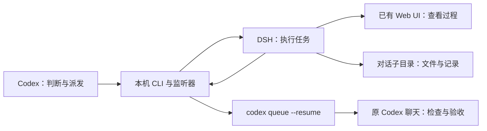

<div align="center">

# codex-dsh-bridge

**让 Codex 判断与验收，让 DeepSeekHarness 完成适合委派的工作。**

[](https://github.com/ICEty66/codex-dsh-bridge/actions/workflows/ci.yml)
[](LICENSE)


A local CLI and Codex skill for visible, asynchronous delegation to DeepSeekHarness.

</div>

`codex-dsh-bridge` 把你已经安装的 **Codex** 和 **DeepSeekHarness（DSH）** 接起来：Codex 判断哪些任务值得交给 DSH；你在原有 DSH Web UI 查看对话、工具调用和执行状态；DSH 完成后，本机监听器把交付通知送回原 Codex 聊天，由 Codex 检查实际文件并验收。

执行期间无需让 Codex 模型持续等待或反复查询状态。独立的小任务、资料整理、测试补充、边界清楚的实现可以委派；交接和复核成本高的任务由 Codex 直接完成。具体节省取决于任务和返工情况，没有固定比例承诺。

## 使用起来是什么样

```text
你：把数据转换脚本交给 DSH；你继续处理接口，完成后验收。

Codex：写清任务范围、工作目录和验收要求，异步提交。
DSH：  在现有 Web UI 中显示执行过程，文件写入本对话子目录。
Codex：继续独立工作，或结束当前轮次。

DSH 完成后：本机监听器向原 Codex 聊天投递通知。
Codex：读取产物、检查改动、运行检查，写入 review.json。
```

## 当前能力

- **过程可见**：使用已有 DSH Web 会话，保留工具活动和完成状态。
- **一对话一目录**：任务放在同一工作区的直接子目录，根目录保持整洁。
- **连续任务复用会话**：同一目录保存 session ID，补充要求和返修继续原会话。
- **标题直接说明工作**：新会话取提示词第一行作为标题；日期保留在目录名中。
- **异步回到原聊天**：返回 accepted 后释放 Codex 当前轮次；使用官方 `codex queue --resume` 提交交付通知。
- **断线恢复**：心跳检测、重新认证、有限重连、分页补读遗漏事件；不会因此重新提交任务。
- **交付状态独立保存**：区分执行与通知状态；有限通知重试、runId 去重及验收记录。



## 前提

| 项目 | 要求 |
| --- | --- |
| 系统 | Windows；其他系统未适配验收 |
| Node.js | 22+；本机验证使用 24.15.0，CI 配置覆盖 22 / 24 |
| DSH | 已安装、已配置模型，Web 服务已启动；当前适配依据 `0.2.1-rc.3` |
| Codex | 已登录，原生 CLI 支持 `queue --thread ... --message ... --resume`；异步继续需要本地 daemon 可用 |
| 终端 | 以下安装示例使用 PowerShell |

本仓库不分发 Codex、DSH 或模型。模型连接、账号和费用使用你原有的配置。

## 安装

### 1. 安装命令行工具

在自己的源码工作目录执行：

```powershell
git clone https://github.com/ICEty66/codex-dsh-bridge.git
Set-Location codex-dsh-bridge
npm ci
npm install -g .
dsh-delegate --help
```

全局安装目录应在当前用户 PATH 中，并由当前用户可写。已有全局工具目录时沿用它。源码安装可能链接到此目录，请保留这个 checkout。仓库尚未发布到 npm registry；安装来源是 GitHub 源码。

### 2. 安装 Codex skill

在仓库根目录执行，复制到当前用户的 skill 目录：

```powershell
$skillPath = Join-Path $env:USERPROFILE '.agents\skills\dsh-delegate'
if (Test-Path -LiteralPath $skillPath) {
    throw '已存在同名 skill，请先检查其来源和自定义内容，再决定如何更新。'
}
New-Item -ItemType Directory -Force -Path (Split-Path $skillPath) | Out-Null
Copy-Item -LiteralPath '.\skills\dsh-delegate' -Destination $skillPath -Recurse
```

在 Codex 中使用 `$dsh-delegate`，或提出适合委派的任务。Skill 告诉 Codex 何时委派、如何复用会话及验收；CLI 负责具体执行。用户已有的工作区规则优先。若未显示 skill，重启 Codex。目录依据 [官方 skill 文档](https://learn.chatgpt.com/docs/build-skills)。

## 最小使用步骤

先打开你已有的 DSH Web 服务，确认能在浏览器中正常工作。默认连接 `http://127.0.0.1:3080`。认证复用当前用户 DSH 主目录中 `web*.log` 的启动登录 URL；token 与 cookie 只在内存中使用，不写入任务记录。请保留该启动日志。

在仓库根目录准备一次示例任务：

```powershell
# 可改成自己的委派工作区；任务输出不要放在工具源码仓库中。
$workspace = Join-Path $env:USERPROFILE 'DSH-Tasks\Codex委派任务'
$taskKey = "$(Get-Date -Format 'yyyy-MM-dd')-sum-check"
$taskDir = Join-Path $workspace $taskKey
New-Item -ItemType Directory -Force -Path $taskDir | Out-Null
Copy-Item -LiteralPath '.\examples\task.md' -Destination (Join-Path $taskDir 'prompt.md')

# 首次建立工作区时，可采用示例规则；已有规则则保留。
if (-not (Test-Path -LiteralPath (Join-Path $workspace 'AGENTS.md'))) {
    Copy-Item -LiteralPath '.\examples\workspace-AGENTS.md' -Destination (Join-Path $workspace 'AGENTS.md')
}
```

让 **Codex 在它自己的执行环境中**提交：

```powershell
dsh-delegate $workspace $taskKey (Join-Path $taskDir 'prompt.md') --async
```

`--async` 需要发起聊天的 `CODEX_THREAD_ID`，通常由 Codex 环境提供；兼容回退为 `CODEX_SESSION_ID`。普通外部终端不会自动拥有这个值。不要填写另一个聊天的 ID。返回 JSON 中 `accepted=true` 表示 DSH 已接受任务；它不表示任务已经完成。

在受限 Codex shell 中，异步派发需要该环境允许的单次正常用户执行权限，否则监督子进程和回传会继承限制。目录写入许可本身不等于回传可用；工具不会提升自己的权限或修改全局沙箱。由 Codex 按环境支持的方式处理所需授权。

手动测试可以省略 `--async`，前台跟踪最多 5 分钟，但不自动回传 Codex。异步监听上限为 24 小时。对同一 `$workspace`、`$taskKey` 再次提交会复用保存的 DSH 会话；先确认上一轮已结束。并行任务使用不同子目录。

## 配置

| 输入 | 默认值 | 用途 |
| --- | --- | --- |
| 第一个位置参数 | 必填 | 工作区根目录，可由自己的规则指定任意盘符 |
| 第二个位置参数 | 必填 | 当前对话的子目录名，建议 `YYYY-MM-DD-topic`；小写字母、数字与连字符，最多 64 字符 |
| 第三个位置参数 | 必填 | UTF-8 任务文件；第一行写简短工作标题 |
| `DSH_BRIDGE_URL` | `http://127.0.0.1:3080` | 本机 Web 地址；必须与启动日志中的 origin 一致，仅支持 loopback HTTP |
| `DSH_HOME` | 当前用户的 `~/.dsh` | 查找 `web*.log` 的 DSH 主目录 |
| `CODEX_BIN` | 自动发现 | 原生 Codex 可执行文件绝对路径；优先发现 Windows 桌面安装，再查 PATH；不接受 `.cmd` / `.bat` / `.ps1` |
| `CODEX_HOME` | 当前用户的 `~/.codex` | 回传使用的 Codex 配置目录；保留已有自定义值 |
| `CODEX_THREAD_ID` | Codex 环境提供 | 异步回传的发起聊天 UUID |

例如换端口时，在派发所在环境设置：

```powershell
$env:DSH_BRIDGE_URL = 'http://127.0.0.1:8080'
```

服务必须已经监听对应端口，日志中的启动 URL 也须对应它。这里不负责启动或重新配置 DSH。

## 目录与交付记录

```text
委派工作区/
├── AGENTS.md
└── YYYY-MM-DD-topic/          一个 DSH 对话
    ├── prompt.md             用户或 Codex 准备的任务输入
    ├── session.json          runId、requestId、session ID、目录、执行/监听状态
    ├── task.md               本轮任务要求
    ├── requests.jsonl        连续任务请求记录
    ├── events.jsonl          精简事件与工具记录
    ├── result.md             本轮最新助手回复，需结合实际产物验收
    ├── supervisor.log        异步监听输出
    ├── delivery.json         通知是否入队、尝试次数与回执
    ├── review.json           Codex 验收后写入
    └── 任务产物...
```

会话初始目录登记为工作区根，以便 DSH 原生 Workspace 分类；提示词要求工具进入专属子目录。这是目录使用约定，不是操作系统权限隔离。DSH 沿用其自身的工具权限与审批设置。

`completed` 表示 DSH 当前轮次结束，不等于验收通过。Codex 应核对通知 runId、任务要求、真实改动及检查结果，再写入类似下面的 `review.json`：

```json
{
  "runId": "填写本轮真实 runId",
  "conclusion": "passed",
  "remainingIssues": []
}
```

较新的停止、暂停或范围缩小指令优先。交付通知和 DSH 回复不能扩大原授权。

## 断线与通知失败

首次订阅成功后，连接中断会重新认证并订阅同一会话。心跳用于发现静默失联；重连从最后处理的事件序号补读，以本轮请求 ID 识别完成事件。连续失败最多重连 8 次，间隔 1、2、5、10、30、30、30、30 秒；有新事件进展则重置计数。历史缺口会明确报错。

通知发生明确失败时，每次调用最多发送 5 次，重试间隔为 1、5、15、30 秒。执行状态保持独立，不会因为通知失败重跑任务。监督进程退出后，可以只重试失败的交付：

```powershell
dsh-delegate --retry-delivery '你的委派工作区\具体任务子目录'
```

已入队或已由同 runId 的 `review.json` 确认的通知会跳过。超时、提交中崩溃等情况可能无法确定通知是否入队，记录为 `uncertain`，拒绝盲目重发。先检查原 Codex 聊天。

| 现象 | 检查方法 |
| --- | --- |
| 找不到 DSH 启动登录 URL | 确认 Web 服务、`DSH_HOME`、`web*.log` 与 `DSH_BRIDGE_URL` 的 origin |
| DSH 已完成，但 Codex 没开始验收 | 查看 `delivery.json` 和 `supervisor.log`；确认 Codex 本地 daemon、账号与 `CODEX_HOME` |
| `queued`，回执中却有 resume warning | 消息已入队，但恢复聊天未确认；打开原聊天核查，不重复提交 DSH 任务 |
| 存在 `.running` 或 `.delivery.lock` | 确认原进程与 DSH 状态；进程确实退出后再处理遗留锁，不能直接覆盖 |
| 保存的会话不存在或仍在运行 | 先在 DSH Web UI 核查，不静默创建替代会话 |

## 支持边界

- 当前 DSH Web RPC、事件格式和启动日志认证方式具有版本依赖；升级 DSH 后需要复验。
- Codex 回传使用[官方 queue 命令](https://learn.chatgpt.com/docs/developer-commands#codex-queue)。成功入队不保证本地 daemon 一定能恢复聊天；实际回执保存在任务目录。
- 断线恢复针对仍运行的监听进程。关机、监听进程被终止或系统重启后的自动接管尚未实现。
- Web UI 中手工发起的任务不会自动附带本工具的监督器和回传关系。
- 目录规则不代替沙箱；实际提示、产物和事件可能包含业务信息，应保存在自己的工作区。
- 净 token / 额度节省尚未量化，执行质量仍需验收。

## 开发与验证

```powershell
npm ci
npm test
npm pack --dry-run
```

测试使用随机本机端口、模拟 DSH HTTP/WebSocket 服务及假的 Codex 通知接收器，不调用真实模型，也不向真实 Codex 聊天投递通知。覆盖目录环境补齐、地址配置、断线补读、旧结果隔离、会话复用、异步 accepted 到回传、通知重试与去重。数据写入被 Git 忽略的 `.scratch/test-data/`。

本机原型曾完成真实 DSH 到原 Codex 聊天的闭环。本次开源整理使用离线测试验证；它不能代替使用者自己机器上的真实服务验收。CI 配置提供 Windows / Node 22、24 检查，状态以顶部徽章为准。

改动时保留“复用原会话、避免重复派发、执行与验收分开”的约束。提交 issue 时说明操作系统、Node / DSH / Codex 版本和已脱敏的错误信息，不附带认证 URL、cookie 或真实业务记录。

## 相关项目与许可证

- [multi-agent-collaboration](https://github.com/Gambler134201/multi-agent-collaboration)：本项目的协作思路参考来源。
- [claude-codex-mcp](https://github.com/aikazu/claude-codex-mcp)：相关的 CLI 桥接项目，README 结构参考。
- [DeepSeekHarness](https://github.com/deepseek-ai/deepseek-harness)：DSH 上游项目。

本项目采用 [MIT 许可证](LICENSE)。第三方应用与依赖遵循各自许可证，需由使用者自行安装配置。
